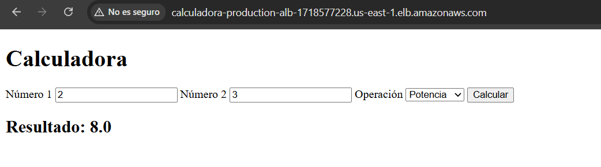
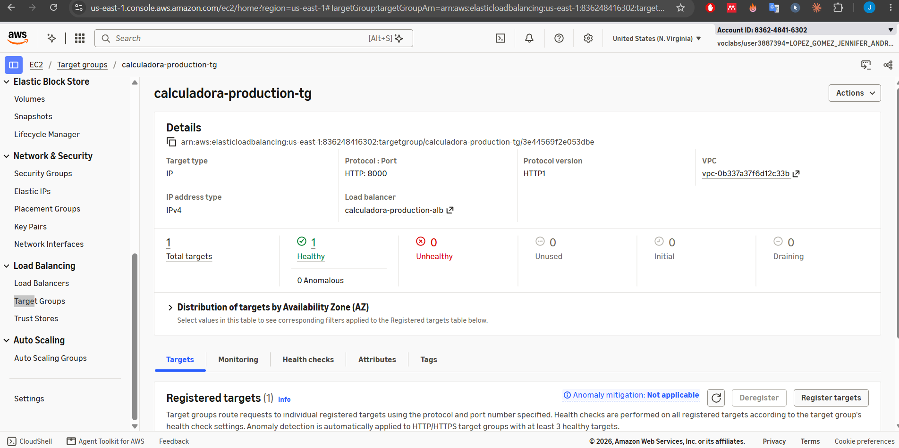

# Calculadora Flask con pipeline de CI/CD

Aplicación web de calculadora en Python/Flask con un pipeline de CI/CD en GitHub Actions: pruebas, análisis en SonarCloud, publicación de la imagen en Docker Hub y despliegue en AWS ECS con Terraform.

- **Repositorio:** https://github.com/jalopezg4/cicd-pipeline-python-cd
- **SonarCloud:** https://sonarcloud.io/project/overview?id=jalopezg4_cicd-pipeline-python-cd
- **Docker Hub:** https://hub.docker.com/r/jenniferlopez2005/cicd-pipeline-python-cd

## Integrantes

Los nombres están en el mismo orden que la variable `AUTOR` de `app/calculadora.py`.

| # | Nombre completo | Usuario de GitHub |
|---|-----------------|-------------------|
| 1 | Jennifer Andrea Lopez Gomez | [@jalopezg4](https://github.com/jalopezg4) (**propietaria del repositorio**) |
| 2 | Santiago Alexander cardenas Laverde | [@AIDouglas](https://github.com/AIDouglas) |
| 3 | Danna Salazar Cardenas | [@dannx109](https://github.com/dannx109) |
| 4 | Samuel Cadavid Zapata | [@scadavidzea](https://github.com/scadavidzea) |

## Evidencias

- **Ejecución del pipeline del merge (5 jobs en verde y aprobación de Producción):** https://github.com/jalopezg4/cicd-pipeline-python-cd/actions/runs/43620043373
- **Pull Request de las nuevas funciones (potencia y módulo):** https://github.com/jalopezg4/cicd-pipeline-python-cd/pull/1
- **Staging:** http://calculadora-staging-alb-941346094.us-east-1.elb.amazonaws.com/
- **Producción:** http://calculadora-production-alb-1718577228.us-east-1.elb.amazonaws.com/

### Producción con una operación nueva

### Target Group de producción en estado healthy

## Preguntas

### 1. Explica el flujo completo que implementaste (commit → `build-and-test` → `deploy-staging` → `test-staging` → aprobación → `deploy-production` → `smoke-test-production`). Sé específico sobre qué artefacto se mueve entre los jobs, qué hace cada job y qué valida cada tipo de prueba.

Lo que pasa de un job a otro es la **imagen Docker** con el SHA del commit como etiqueta (`usuario/cicd-pipeline-python-cd:<sha>`). Se arma una sola vez y esa misma es la que llega a staging y a producción.

1. **build-and-test:** revisa el código, corre las pruebas unitarias y de componente, arma la imagen y le corre las pruebas de aceptación. Si todo pasa, la sube a Docker Hub.
2. **deploy-staging:** con Terraform actualiza el servicio de ECS de staging con la imagen nueva.
3. **test-staging:** prueba la calculadora en staging como si fuera un usuario de verdad.
4. **deploy-production:** se queda esperando que alguien del equipo apruebe, y ahí sí despliega la misma imagen en producción.
5. **smoke-test-production:** pruebas rapiditas que solo revisan que la página cargue y que `/health` diga `ok` con la versión correcta.

### 2. ¿Qué ventajas y desventajas encontraste al usar Terraform en vez de crear la infraestructura manualmente desde la consola? ¿Por qué el estado de Terraform se guarda en un bucket S3 y no en tu computador?

**Ventajas:** la infraestructura queda escrita en código, entonces se puede revisar en un PR, repetir igualita para staging y producción y borrar todo con un solo comando. En la consola uno da clics y después no se acuerda qué cambió.

**Desventajas:** toca aprender el lenguaje, y si uno cambia algo a mano en la consola, Terraform se desfasa. Para algo pequeñito a veces es más rápido la consola.

**¿Por qué S3?** Porque así lo ven tanto el pipeline como todo el equipo. Si estuviera en mi PC, el pipeline no sabría qué hay creado en AWS y lo crearía otra vez.

### 3. ¿Qué ventajas y desventajas tiene introducir un entorno de Staging en el pipeline de despliegue a AWS? ¿Cómo impacta esto la velocidad vs. la seguridad del despliegue?

**Ventajas:** es un ensayo antes de producción. Los errores salen ahí y no los ve el usuario. Además se prueba en AWS de verdad, no solo en el contenedor del pipeline. Por ejemplo, ahí salió el problema de Chrome con HTTP que en local no pasaba.

**Desventajas:** cuesta plata (otro Load Balancer y otra tarea de Fargate) y hace el pipeline más lento, porque hay que esperar dos despliegues y la aprobación.

**Velocidad vs. seguridad:** uno pierde unos minutos en cada entrega, pero gana mucha tranquilidad. Para una app que usa gente real, vale la pena.

### 4. ¿Qué diferencia hay entre las pruebas ejecutadas contra Staging (`test-staging`) y las ejecutadas contra Producción (`smoke-test-production`) en tu pipeline? ¿Por qué esta diferencia?

`test-staging` corre todas las pruebas de aceptación con Selenium: llena el formulario, hace las operaciones y revisa los resultados. Es completa pero más demorada.

`smoke-test-production` es rapida: solo revisa que la página cargue y que `/health` diga `ok` con la versión que se acaba de desplegar. Existe porque en producción no queremos meter pruebas pesadas, solo confirmar que lo que acabamos de subir quedó vivo y es la versión correcta. Lo de fondo ya se probó en staging.

### 5. Considerando un ciclo completo de DevOps, ¿qué partes importantes (fases, herramientas, prácticas) crees que aún le faltan a este pipeline de CI/CD que has construido? (Menciona 2, explica por qué son importantes y cómo podrían implementarse brevemente).

1. **Monitoreo y alertas.** Si producción se cae, hoy nadie se entera. Se arregla con alarmas de CloudWatch que manden un correo cuando el ALB empiece a dar errores.
2. **Seguridad.** La app va por HTTP y no se revisa si la imagen tiene vulnerabilidades. Se arregla poniendo HTTPS con un certificado de ACM y escaneando la imagen con Trivy en el pipeline.

### 6. ¿Cómo les pareció implementar las dos funcionalidades nuevas con el pipeline completo? ¿Encontraron útil el CI/CD al hacer cambios y despliegues? ¿Qué no fue tan útil? Cada integrante responde con su experiencia propia, identificándose con su nombre.

- **Jennifer Andrea Lopez Gomez:** Lo más útil fue ver que con un merge todo se despliega solo, sin entrar a AWS a dar clics. Lo que no me gustó es que las credenciales del Learner Lab se vencen y toca actualizar los secrets a cada rato.
- **Santiago Alexander cardenas Laverde:** Me sirvió mucho ver que staging atajó un error antes de producción: las pruebas de Selenium fallaban porque Chrome intentaba pasar a HTTPS. Lo maluco es que cada vuelta del pipeline completo se demora varios minutos.
- **Danna Salazar Cardenas:** Me gustó que la imagen que se prueba es la misma que llega a producción, eso da confianza. Lo que más me costó fue entender Terraform y los workspaces al principio.
- **Samuel Cadavid Zapata:** Lo más útil fue la aprobación manual de producción, porque uno revisa staging antes de soltar el cambio. Lo que no me gustó es estar pendiente de destruir los recursos para no gastarse el presupuesto.

### 7. Con la aprobación manual, ¿su pipeline implementa Entrega Continua o Despliegue Continuo? ¿Por qué? ¿Qué revisaron en Staging antes de aprobar el paso a Producción? Si una versión nueva no lograra pasar el health check, ¿qué haría ECS y cómo lo detectaría el pipeline?

Es **Entrega Continua**. Todo llega automático hasta staging, pero para pasar a producción alguien del equipo tiene que aprobar en el entorno `production`. En Despliegue Continuo no habría esa aprobación y se iría derecho.

**Qué revisamos en staging antes de aprobar:** que `test-staging` estuviera en verde, que `/health` mostrara el SHA del commit y que las operaciones nuevas (potencia y módulo) funcionaran entrando a la URL de staging.

**Si una versión no pasa el health check:** ECS sigue con la versión vieja y, por el *circuit breaker*, se devuelve solito a ella. El pipeline se da cuenta porque el `terraform apply` falla al no quedar estable el servicio, y el job queda en rojo.
